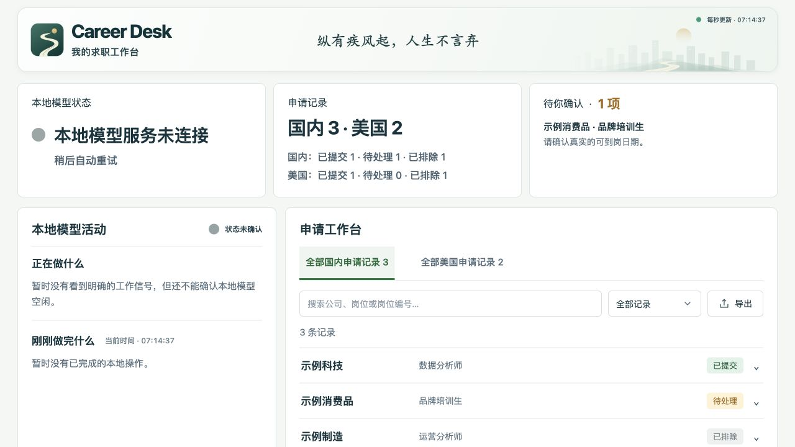

# Career Desk

一个为个人使用设计的本地求职工作台：在同一页查看本地模型活动、国内／美国申请记录，以及需要本人确认的问题。配合 Work 分派任务、本地模型起草材料、人工审核的工作方式使用。

这是从个人工作台整理出来的 **可运行参考版**，附合成示例数据，不包含原作者的申请记录、简历、聊天日志、模型文件或账号配置。它不是招聘网站的自动投递工具。



## 快速开始

建议 macOS、Python 3.13。兼容代码目标为 Python 3.11–3.13；当前验证环境是 macOS / Python 3.13。不需要安装模型即可查看示例工作台。

解压后，在此目录运行：

```sh
./setup.sh
./start.sh
```

打开 **http://127.0.0.1:8780/**。首次启动会将 `examples/` 中的三个数据文件复制到 `data/`，后续启动不会覆盖。关闭终端或按 Control+C 结束参考版服务。

如果 Python 命令另有名称，可用 `PYTHON=python3.13 ./setup.sh`。Windows 可依次运行 `py -3.13 -m venv .venv`、`.venv\Scripts\python -m pip install -r requirements.txt`、`.venv\Scripts\python -m career_desk`；Windows 尚未实机验证。

## 能做什么

- 动态显示 Ollama 已加载的本地模型；不把“已安装”当成“已加载”。
- 已接入请求开始时红灯忙碌，结束后绿灯空闲；监测断开时显示不可用。
- 显示请求的用户内容摘要、完成时间、来源标签；保留最近 **25 条正常完成记录**，刷新网页后仍保留。正常完成显示在“刚刚做完什么”；取消／异常不会冒充成功。
- 国内、美国记录分别显示，只有“已提交／待处理／已排除”三种状态；搜索、分页、导出 CSV。
- 待确认事项按新到旧显示，内容可滚动；记录与资料每秒读取更新。
- 通过后台线程写入监测摘要；文件写入失败不会阻塞模型回答，不会自动重发模型请求。

## 接入本地模型

先按 [Ollama 官方说明](https://docs.ollama.com/) 安装并运行 Ollama，选择你电脑能够运行的模型。工作台不会下载、替换或重启模型。

参考版使用两个独立端口：

| 用途 | 默认地址 |
|---|---|
| 工作台 | `http://127.0.0.1:8780` |
| 可选监测代理 | `http://127.0.0.1:11439` |
| 原有 Ollama 上游 | `http://127.0.0.1:11434` |

**只有明确发送到 11439 的本地模型请求才被监测。** 绿灯表示已接入的调用空闲，不代表所有软件均未使用模型。不能把一般网页操作、Work 自身动作或模型保留在内存中当成模型正在处理请求。

例如，在新终端为一次 CLI 调用指定地址：

```sh
OLLAMA_HOST=http://127.0.0.1:11439 ollama run YOUR_MODEL_NAME
```

`YOUR_MODEL_NAME` 用 `ollama list` 中的实际本地模型名称替换。模型必须已出现在上游的 `/api/tags` 列表中；带有远程来源或 `:cloud` 标记的模型不会计入本地活动。

Work／其他本机程序也可把本地模型 API 地址设置为 11439。可附 `X-Chat-Name` 来源标签、`X-Codex-Thread-Id` 聊天编号。**仅设置聊天编号不会让程序自动读取聊天名称或聊天内容。** 不改变 ChatGPT 自身的云端模型地址。

Ollama App 如果不支持设置 API 地址，其直接调用仍不会被这个参考版捕获。参考版不接管默认端口、不读取其他程序的私人日志，也不承诺所有调用方式自动接入。云端运行的 Work 无法直接访问你电脑的 localhost；远程接入不属于本项目范围。

端口冲突时程序直接报错，不关闭已有程序。可配置：

```sh
./start.sh --port 8781 --proxy-port 11440 --upstream http://127.0.0.1:11434 --data ./data
```

## 一个真实模型起草例子

先启动工作台，然后另开终端：

```sh
.venv/bin/python -m career_desk.draft --model YOUR_MODEL_NAME --jd examples/job.txt --profile data/profile.json --output draft.txt
```

只发送一次请求，生成待审核草稿；不会上传简历、操控浏览器或提交申请。资料缺失应由模型列为问题，输出仍须人工核对。

## 使用自己的记录

完整字段说明见 [数据格式](docs/DATA.md)。把自己的已确认资料和记录放在 `data/`，不要放入 `examples/`。

Work 可以在用户授权下维护这些文件，建议先写临时文件再原子替换。工作台每秒自动读取；它不会自行推断你已确认某件事。维护端把事项标为 `resolved: true` 后，工作台下一次更新会将它移除。

## 安全停止与监测限制

模型转发不自动重试。请求发出后发生网络异常，不能据此认定模型没有执行，不要无脑重发。监测摘要最多保留 25 条；不保存完整模型回答，但摘要可能含私人信息。

本参考版没有常驻系统服务，也没有接管默认 Ollama 端口。关闭参考版后，原有 Ollama 直连保持可用；仍指向 11439 的客户端需要主动切回原地址。**没有对当前请求自动重试或透明故障回退。** 这是避免重复推理的明确取舍。

模型输入内容只能说明“收到什么请求”，不能窥视模型内部思考，也不能据此保证它没有卡住。没有输出一段时间不等于故障；取消／中断记录与正常完成分开处理。多个并发请求时，只要仍有一个在执行，活动灯就保持忙碌。

## 测试

```sh
.venv/bin/python -m pip install -r requirements-dev.txt
.venv/bin/python -m pytest -q
```

测试使用隔离的模拟上游，不调用你的真实 Ollama，不占用真实模型显存，也不读取原工作台数据。验证记录见 [VALIDATION.md](docs/VALIDATION.md)。

## 开源许可与数据隐私

`career_desk/` 是工作台与可选代理；`examples/` 全部为合成内容；`tests/` 为隔离验证。没有附带模型权重，也没有引用原工作台的私人目录。

本地数据、虚拟环境、生成草稿均由 `.gitignore` 排除。上传之前仍应检查 Git 暂存列表。本项目采用 [MIT 许可证](LICENSE)：允许使用、修改与分发，需保留版权和许可证声明。第三方依赖采用各自许可证，系统字体未打包分发。

发布内容与隐私检查说明见 [PRIVACY.md](docs/PRIVACY.md)。
