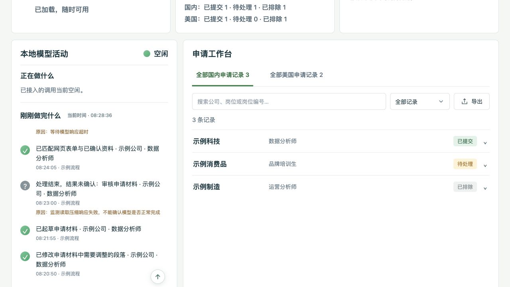

# 本地模型活动记录（0.2.0）

工作台在一页展示“正在做什么”和“刚刚做完什么”。监测范围仍是明确发送到参考版代理的本地模型请求；没有扩大为对所有软件的自动监控。

## 最近 100 次处理

结束记录统一保留最近 100 次独立处理，新记录替换最旧的。不按时间额外过期；刷新或正常重启后仍保留。正常完成、中断、取消和结果未确认都能留下记录，异常不会显示成绿色成功。

每条时间是本次处理结束的时间，不是整个求职任务开始的时间。一个求职任务可能有起草、审核、修改等多次模型处理，各自记录。合并重复观察记录后，现存数量可能不足 100；不会制造历史记录补满。

## 具体动作与去重

例如“已起草申请材料”“已审核中文申请材料”“已修改申请问题的回答”“已匹配网页表单与已确认资料”。有明确岗位资料时附上公司和岗位；调用方没有提供的信息不会猜测。

内置起草命令自动提供动作类型和新的调用编号。其他本机调用程序可以附加：

| 请求头 | 用途 |
|---|---|
| `X-Local-Model-Call-Id` | 本次调用的 UUID（32 位十六进制，或标准带连字符格式） |
| `X-Local-Model-Role` | 已知动作类型，如 writer、independent_reviewer、field_mapper、field_repair |
| `X-Chat-Name` | 自己提供的来源名称；非 ASCII 名称可用 JSON 字符串转义后的内容 |

同一次处理的多份观察记录复用调用编号，记录只保留一次。**另一次起草、重写或独立请求必须使用新编号**；不能因为输入相同就复用编号。没有编号的请求使用代理自己的独立编号，不按描述相同或时间接近随意合并。

兼容已存在的内部／转发两种观察记录时，明确关联优先；旧数据只有在调用方、模型、完整起止边界均对应且匹配唯一时才合并。并发关系无法确定时保留，避免把两次真实处理吞掉。

模型调用被标为验证用途时，也会留下真实处理的结束记录，不再出现“红灯忙过、做完却被隐藏”的显示差异。这里没有创建或展示额外的验收任务模块。

## 异常原因

异常行下方显示“原因：”。能确认时区分调用方取消、连接中断、等待超时、HTTP 服务错误、模型返回不完整、内存不足，以及监测自身无法读取响应等情况。

旧记录没有详细原因的，会明确显示“当时未记录具体原因”。监测读取响应失败只代表无法确认结果，不等于模型必然运行失败。异常信息会限制长度并遮蔽常见凭据和本机用户路径；仍应把自己的整个 data/ 目录视为私人数据。

转发不自动重试，不会为补记录重复执行请求。记录写入仍在后台线程进行，写入失败不阻塞模型结果。

## 向上箭头

历史列表向下滚动后，右下方出现纯 **↑** 图标按钮。点击仅返回这份列表的顶部；回到顶部自动隐藏。支持键盘操作、无障碍名称及减少动画设置。

以下为合成示例界面，不含真实投递或个人资料：

## 从旧版更新

使用 ZIP 的人可下载新版到新目录，先停止**旧的参考版工作台**，将自己的 data/ 本地复制到新版同名位置，再按原参数启动。不要把 data/ 上传到 GitHub，也不要覆盖自己的原始资料。

使用 Git 的人可在没有未提交代码改动时执行 `git pull --ff-only`，再按原来的数据目录和端口启动。已有个人文件由忽略规则保护，程序不会自动清空或重新填充。正式更换进程前先结束本次模型调用；不要用重启来中断正在生成的请求。

旧 recent.json 和独立的 last_interruption.json 会被自动读取并归入新的结束记录，不需要重新运行旧任务。原申请表、已确认资料和待确认问题的格式保持不变。
