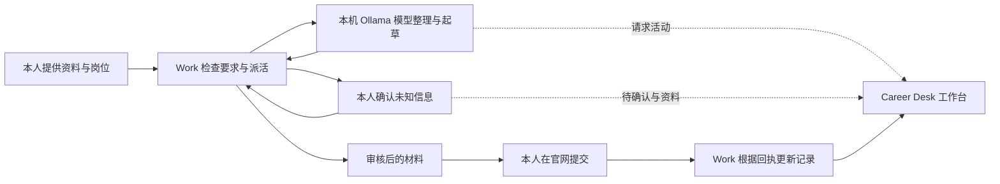

# 从零搭建：Work 派活、本地模型处理、工作台记录

目标是复现一套分工明确的求职流程：本人给出真实资料和目标，Work 分派任务并审核，本地模型完成内容整理与起草，工作台显示本地模型活动、申请记录和待确认问题。

本指南先让你在自己的电脑上跑通一轮，再处理真实岗位。无需照搬原作者的硬件、私人资料或模型别名。



本地模型在这里负责生成和分析文字，不会仅因安装了模型就自己操控浏览器。实际网页填写需要本人操作，或由另行授权并具备浏览器工具的 Work 完成。本项目不附带通用网站自动填写器。

## 1. 准备什么

| 项目 | 用途 | 是否必须 |
|---|---|---|
| Python 3.13 | 运行工作台与调用脚本 | 必须；代码目标为 3.11–3.13 |
| Ollama | 在自己的电脑上运行模型 | 使用真实本地模型时必须 |
| 一个能在电脑上运行的本地模型 | 整理岗位、起草材料 | 使用真实流程时必须 |
| 能访问本机文件与终端的 Work／Codex 聊天 | 分派本地脚本任务、审核、维护记录 | 复现 Work 分工时必须 |
| 浏览器 | 查看工作台、在官网检查和提交 | 必须 |
| Git | 下载与更新代码 | 可选，也可以下载 ZIP |

先按 **macOS** 步骤使用。自动测试覆盖 macOS 与 Linux；Windows 只有命令参考，没有完整实机使用验收。Work 的权限、界面与账号可用性以你当前产品为准，本仓库不包含 OpenAI 账号或订阅。

- Python：[官方下载页面](https://www.python.org/downloads/)。安装 3.13 系列；若默认 `python3` 指向 3.14，请在后文改用 `python3.13`。
- Ollama：[官方下载与运行说明](https://docs.ollama.com/quickstart)。安装后启动 Ollama App，让模型服务保持运行。
- Work／Codex：使用能访问这台电脑的本地环境，并选择本项目文件夹。[OpenAI 官方本地环境说明](https://learn.chatgpt.com/docs/environments/local-environment)介绍了本机项目和终端的使用方式。普通网页聊天、未连接本机的云端任务，不能仅凭一段提示词就访问本机模型。

本项目不需要 OpenAI API Key。Work 自己的账号、使用额度与工具权限仍按对应产品规则计算。

## 2. 下载代码，安装并打开示例工作台

在 [仓库首页](https://github.com/raymond99-sol/job-search-application-workflow) 点击 **Code → Download ZIP**，解压，然后在终端进入解压后的目录。也可以安装 Git 后运行：

```sh
git clone https://github.com/raymond99-sol/job-search-application-workflow.git
cd job-search-application-workflow
```

下面所有命令均在包含 README.md 的项目根目录运行：

```sh
PYTHON=python3.13 ./setup.sh
./start.sh
```

若 `python3 --version` 已是 3.13，可直接运行 `./setup.sh`。浏览器打开 **http://127.0.0.1:8780/**，应看到“国内 3 · 美国 2”和一项示例待确认。这些都是演示数据。

保持终端运行，工作台才在线。此时不连接模型也能查看页面；模型状态显示未连接是正常的。接下来在启动服务的终端按 **Control+C**，准备切换到自己的空白工作区。

**成功标志：** 页面能打开，国内／美国标签能切换。打不开时先看终端报错，不要反复开多个启动窗口。

## 3. 安装并确认本地模型

另开一个终端，确认 Ollama 命令可用：

```sh
ollama --version
ollama list
```

若尚未安装模型，可先用 Ollama 官方快速开始中的小型示例：

```sh
ollama run gemma4:e2b
```

首次会下载模型，实际下载量、速度和运行要求以模型页面为准。能回答一句简单问题后，输入 `/bye` 退出对话；不要退出 Ollama App 的后台服务。也可自行选择适合硬件的千问等模型。

后续的 `YOUR_MODEL_NAME` 都要替换成 **你自己的 `ollama list` 中显示的完整名称**，不要原样照抄占位符。原作者的自定义 MLX 别名不一定存在于其他电脑。

**成功标志：** `ollama list` 能找到模型，而且一次简单聊天能正常回答。模型能回答不等于申请材料无需审核。

## 4. 建立自己的空白资料区

在项目根目录运行一次：

```sh
.venv/bin/python -m career_desk.records --data data/personal init
```

这会生成空白申请表、空白已确认资料、空白待确认清单，以及 inputs、drafts 两个目录。已有目录会拒绝覆盖，不会清空旧资料。

把 `templates/background.txt` 的内容复制到 `data/personal/inputs/background.txt`，用自己的真实资料填写。把 `templates/job.txt` 复制到 `data/personal/inputs/job-001.txt`，填入一个真实目标岗位。文件也可以让 Work 根据你的明确说明创建。

不要把自己的资料填进 templates 或 examples；这些目录会随仓库公开。`data/` 已被 Git 忽略。

启动自己的工作台：

```sh
./start.sh --data data/personal
```

**成功标志：** 申请数量从示例数变成零，待确认事项为空。这是你的新数据区。示例数据仍在原处，不会混入个人记录。

## 5. 把分工交给 Work

在能访问本机文件和终端的 Work／Codex 中，打开 **这个项目目录**，使用同一份本地工作副本；不要为这一轮切到另一个没有 data/ 的新工作树。

复制 [首次接入指令](../prompts/WORK_STARTER.md) 的正文到聊天。只替换三项：

1. 项目目录：你解压或克隆后的实际目录。
2. 本地模型名：刚才 `ollama list` 的结果。
3. 本人资料与岗位文件：第 4 步创建的两个文件。

Work 应先读取说明，核对本机目录、模型地址和本人资料；从本人提供的资料中提取可确认事实到 `data/personal/profile.json`。歧义事实先登记为问题，不得自己补齐。然后检查岗位资格、重复记录，再调用起草脚本。脚本通过工作台的 11439 地址调用模型，Work 自己仍保持原有云端模型配置。

以下是 Work 实际应调用的命令形式（替换模型名称）：

```sh
.venv/bin/python -m career_desk.draft --model YOUR_MODEL_NAME --jd data/personal/inputs/job-001.txt --profile data/personal/profile.json --output data/personal/drafts/job-001.txt --chat "求职流程"
```

不想先用 Work 的话，也可以自己在终端运行同一条命令验证本地环节。

**成功标志：** 工作台短暂显示红灯忙碌和请求摘要，完成后变绿灯，刚刚做完列表新增一条；草稿文件出现。非常短的请求可能在两次一秒刷新之间结束，忙碌红灯不一定来得及看见，但完成记录应保留。

这里显示的是请求内容摘要，不是模型内部思考，也不是对全部软件调用的旁观。直接连默认 Ollama 地址的其他客户端不会自动出现在参考版里。

## 6. 让 Work 审核，而不是照单全收

使用 [日常任务指令](../prompts/DAILY_TASK.md)，让 Work 核查：

- 学历、毕业时间、地区、工作资格等硬性要求是否符合。
- 每段材料能否追溯到本人已经提供或确认的资料。
- 是否出现编造经历、数值、工具、语言能力或资格。
- 未知必填字段是否列入待确认清单，而非随意填写。
- 生成材料与最终提交原件是否分开，原简历是否保持不变。

草稿存在仅表示生成完成，不表示申请已提交。本地模型不可靠的输出应退回修改或由本人补充；不能为“省额度”跳过审核。

## 7. 待确认问题与资料如何联动

Work 发现问题时，可运行：

```sh
.venv/bin/python -m career_desk.records --data data/personal question --id q-job-001-start --market CN --company "实际公司" --role "实际岗位" --text "请确认你的可到岗日期。"
```

工作台下一次更新会显示问题。每个问题使用稳定且唯一的编号，新问题用新编号。

本人在聊天明确回答后，由 Work 保存真实答案：

```sh
.venv/bin/python -m career_desk.records --data data/personal answer --id q-job-001-start --text "这里填写本人刚刚明确确认的真实答案"
```

此命令先保存已确认资料，再移除待确认项。问题消失和资料数变化会由工作台自动显示，你不需要再去面板点一次“确认”。**前提是 Work 已执行保存；面板不会自己读取聊天、猜测你已回答。** 如果 Work 还没保存，可以直接说“把我刚确认的答案记入资料并更新工作台”。

同一问题不会重复写入；原答案改变时登记新问题，保留确认来由。

## 8. 申请记录如何更新

每个岗位使用一个稳定编号，例如 `cn-job-001` 或 `us-job-001`；状态变化仍使用同一编号。让 Work 先查现有记录，不重复登记同一岗位。不同岗位编号不要因为公司相同就合并。

准备过程中：

```sh
.venv/bin/python -m career_desk.records --data data/personal application --id cn-job-001 --market CN --company "实际公司" --role "实际岗位" --status attention --note "材料待审核，尚未提交"
```

本人在官网提交，并取得回执或明确成功页面后，让 Work 根据该证据更新同一条记录：

```sh
.venv/bin/python -m career_desk.records --data data/personal application --id cn-job-001 --market CN --company "实际公司" --role "实际岗位" --status submitted --note "填写实际提交确认依据；不是准备完成"
```

若确认不再申请，改为 `--status excluded`，并在 `--note` 记录真实原因。美国岗位使用 `--market US` 和相应编号。

工具仅记录你或 Work 提供的证据说明，不会自行校验网站是否提交成功。没有成功依据时不得标为 submitted。后续收到拒信仍应保留曾经提交的事实，可在说明中记录结果，不要把它伪装成未投递的排除项。

**成功标志：** 相应地区总数、状态计数和列表在下一次更新中一起变化；修改同一条记录的状态不会把总数再加一。

## 9. 以后每天怎么用

1. 保持 Ollama 运行，在项目根目录运行 `./start.sh --data data/personal`。
2. 将新岗位保存到 inputs，给 Work [日常任务指令](../prompts/DAILY_TASK.md)。同一聊天可直接继续；新聊天重新提供项目目录和指令。
3. Work 读取已有事实、问题与记录，再调用本地模型；你通过工作台看活动和需要确认的问题。
4. 在聊天回答问题，让 Work 保存；审核材料后由本人提交，或另行明确授权具备相应工具的 Work 操作。
5. 根据真实回执维护记录。资料和本地摘要留在 data/，不上传到 GitHub。

## 10. 常见卡点

| 现象 | 处理 |
|---|---|
| `python3.13` 找不到 | 安装 Python 3.13；重新打开终端后确认 `python3.13 --version` |
| `ollama` 找不到或服务未连接 | 检查官方安装是否完成，启动 Ollama App；按其官方说明确认 CLI 可用 |
| 模型找不到 | 把命令中的模型名换成 `ollama list` 中真实名称 |
| 端口占用 | 先确认是否已启动一份工作台，不要杀掉其他程序；更换端口时同步修改 Work 的调用地址 |
| 浏览器有页面，Work 却不能调用 | 确认 Work 的命令运行在同一台电脑、同一项目目录，且终端／网络权限允许访问本机服务 |
| 草稿已存在 | 使用新输出文件名；起草脚本拒绝覆盖已有稿件 |
| 问题回答了却未消失 | 检查 Work 是否执行 answer，以及服务和命令是否都指定 data/personal |
| 红灯没看到但有完成记录 | 请求可能不到一秒，刷新时已完成；不是记录丢失 |
| 中断后不确定是否还在运行 | 先检查模型端和已有输出，不自动重发原请求 |
| 写入锁残留 | 先确认没有其他 records 命令运行，再人工移除该数据目录下的 `.records-lock` 空目录；不要在另一个写入尚未完成时移除 |

## 复现到哪一步才算完成

- 能打开自己的空白工作台，并读到实际本地模型状态。
- 一次真实模型起草能产生文件和完成记录。
- Work 能审核结果，提出未知问题；本人回答后由 Work 保存，待确认项消失。
- 登记／修改申请记录后，数量与状态同步变化。
- 知道最终提交由谁执行、如何确认成功，且不会把生成草稿当成提交。

做到这些，就建立了本文分享的工作流。完整招聘网站自动填写、任意客户端调用全覆盖、模型权重分发不包含在本参考版中；这些不是下载仓库后自动获得的能力。
